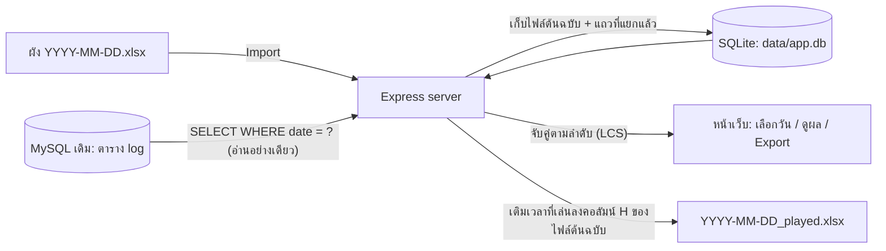

# เว็บเปรียบเทียบผังออกอากาศกับ As-Run Log

เว็บ Node.js สำหรับ import ผังออกอากาศรายวัน (Excel) และเก็บไว้ดูย้อนหลัง แล้วเทียบกับ log จากเครื่องเล่นไฟล์ใน MySQL **แบบสดทุกครั้งที่เปิดดู** เพื่อดูว่าแต่ละรายการในผังเล่นแล้วหรือยัง และเริ่มเล่นกี่โมง คอลัมน์ REMARK เดิมจะถูกแทนด้วย **เวลาที่เล่น** ที่ดึงมาจาก log และ export กลับเป็น Excel ได้โดยรูปแบบยังเหมือนต้นฉบับ

## ข้อสรุปที่ตกลงกันแล้ว

| เรื่อง | ข้อสรุป |
|---|---|
| ช่วง log ที่เทียบ | log ของวันนั้น 00:00–23:59 (`date = วันที่ของผัง`) ไม่ข้ามวัน |
| วันที่ของผัง | อ่านจากชื่อไฟล์ `YYYY-MM-DD.xlsx` |
| คอลัมน์ REMARK | ไม่แสดงและไม่ใช้ แทนด้วย **เวลาที่เล่น** จาก log ทั้งบนเว็บและในไฟล์ export |
| ตาราง log ใน MySQL | คอลัมน์ตรงกับ `asrunlog.json`: `uuid`, `date`, `title`, `startTime`, `endTime`, `duration` |
| ที่เก็บผัง | SQLite แยกต่างหาก ไม่แตะ MySQL เดิม (อ่านอย่างเดียว) |
| การเทียบ | เทียบสดทุกครั้งที่เปิดดู ไม่ล็อกผล |
| Export | Excel ที่คงรูปแบบต้นฉบับ |

## Stack ที่เลือก

| ส่วน | ใช้ | เหตุผล |
|---|---|---|
| Runtime | **Node.js 26** (มีในเครื่องแล้ว) | ใช้ภาษาเดียวทั้งระบบ มี `--env-file`, `node:test`, `node:sqlite` ในตัว ไม่ต้องลงเพิ่ม |
| Web server | **Express 5** | เล็ก คนรู้จักกันกว้าง ใช้ serve ทั้งหน้าเว็บและ API |
| อ่าน log | **mysql2** | driver MySQL มาตรฐานของ Node มี connection pool และ prepared statement ใช้ **SELECT อย่างเดียว** |
| เก็บผังของเว็บ | **SQLite** ผ่าน `node:sqlite` | แยกจาก MySQL เดิม เป็นไฟล์เดียว (`data/app.db`) ไม่มี server ให้ดูแล backup ด้วยการ copy ไฟล์ ข้อมูลวันละไม่กี่ร้อยแถวเหมาะกับ SQLite |
| อ่าน/เขียน Excel | **ExcelJS** | อ่านผังและเขียนไฟล์ export โดย**คงสี ฟอนต์ ความกว้างคอลัมน์ และ merge cell เดิม** ได้ (ดูการเปรียบเทียบด้านล่าง) |
| Frontend | **HTML + CSS + JavaScript ล้วน** (ไม่ต้อง build) | หน้าเดียว ไม่ต้องใช้ framework |

Dependency ที่ต้องติดตั้งมี 3 ตัว: `express`, `mysql2`, `exceljs`

### ExcelJS เทียบกับ SheetJS: ผลเสียของการเปลี่ยน

| ประเด็น | ExcelJS | SheetJS (`xlsx` จาก npm) |
|---|---|---|
| คงรูปแบบต้นฉบับตอน export | ✅ ได้ | ❌ หายหมด (เฉพาะรุ่น Pro ที่เสียเงินทำได้) |
| ความปลอดภัยของแพ็กเกจ | ไม่มีช่องโหว่ร้ายแรงที่รู้จัก | ⚠️ รุ่นบน npm (0.18.5) ไม่อัปเดตแล้ว และมีช่องโหว่ที่รู้จัก (CVE-2023-30533, CVE-2024-22363) รุ่นที่แก้แล้วโหลดได้จาก CDN ของ SheetJS เท่านั้น |
| ขนาดแพ็กเกจ | ใหญ่กว่า (มี dependency ย่อยหลายตัว ประมาณ 20 MB ใน `node_modules`) | เล็ก ไม่มี dependency |
| ความเร็ว | ช้ากว่าเมื่อไฟล์ใหญ่มาก (หลักแสนแถว) | เร็วกว่า |
| การดูแลโปรเจกต์ | ออกรุ่นใหม่ช้า (รุ่นหลักล่าสุด 4.4.0) แต่คนใช้มากและเสถียร | อัปเดตต่อเนื่อง แต่ไม่ลง npm |
| รองรับไฟล์ | `.xlsx` อย่างเดียว ไม่อ่าน `.xls` แบบเก่า | อ่านได้หลายรูปแบบรวมถึง `.xls` |
| ฟีเจอร์ขั้นสูง | กราฟ, pivot table และรูปภาพบางแบบอาจหายตอนบันทึกซ้ำ | หายเหมือนกัน |
| การอ่านค่า cell | ค่าบาง cell เป็น object (rich text, สูตร) ต้องใช้ `cell.text` ช่วย | ได้ค่าเป็นข้อความเลย |

**สรุป:** สำหรับงานนี้ ExcelJS ไม่มีผลเสียที่มีนัยสำคัญ
- ผังมีขนาดประมาณ 370 แถว
- ไฟล์ผังเป็น `.xlsx` และไม่มีกราฟหรือรูปภาพ
- ปัญหาความปลอดภัยของ SheetJS บน npm ยิ่งทำให้ ExcelJS เป็นตัวเลือกที่ดีกว่า

> [!WARNING]
> ถ้าวันหนึ่งได้ผังมาเป็น `.xls` (Excel แบบเก่า) ExcelJS จะอ่านไม่ได้ ระบบจะแจ้งให้เปิดไฟล์แล้ว Save As เป็น `.xlsx` ก่อน

## ภาพรวมการทำงาน



## การจับคู่ (หัวใจของระบบ)

**คีย์ที่ใช้เทียบ:** ชื่อเต็ม (`PROGRAM` ใน Excel กับ `title` ใน log) หลังตัดช่องว่างหัวท้ายและยุบช่องว่างซ้ำให้เหลือช่องเดียว ใช้รหัสหน้า `#` อย่างเดียวไม่ได้ เพราะจากไฟล์จริง:
- `PR-2026-12-31` ใช้กับ 2 สปอตคนละตัว (พระองค์ภา และ พระพันปีหลวง)
- ช่องว่างไม่ตรงกัน เช่น ผังเขียน `ขอเพียงแค่เขียนมา (45วิ) Edit` แต่ log เขียน `ขอเพียงแค่เขียนมา  (45วิ)  Edit`

**วิธีเทียบตามลำดับโดยไม่ข้ามลำดับ:** ใช้ sequence alignment (Longest Common Subsequence) ระหว่างลำดับรายการในผังกับ log ของวันนั้นที่เรียงตามเวลาเริ่มเล่น
- ทั้งสองฝั่งเดินไปข้างหน้าอย่างเดียว ไม่มีการจับคู่ย้อนลำดับ
- log ที่ไม่มีในผัง (ตัวรายการ, ID-Station, โปรโมตแทรก) จะถูกข้ามไป
- รายการในผังที่หาไม่เจอจะได้สถานะ "ไม่พบการเล่น" โดยไม่ทำให้รายการถัดไปเพี้ยน

> [!IMPORTANT]
> **ทำไมไม่ใช้วิธีไล่หาไปข้างหน้าทีละรายการ (greedy):** สปอตเดียวกันออกหลายครั้งต่อวัน เช่น `L23142` ยาสีฟันเทพไทย ออก 7 ครั้ง ถ้ามีรายการในผังที่ไม่ได้เล่น 1 รายการ วิธี greedy จะวิ่งไปจับครั้งที่เล่นในเบรกถัดไป แล้วรายการหลังจากนั้นจะเพี้ยนต่อกันทั้งหมด LCS เลือกการจับคู่ที่ได้จำนวนคู่มากที่สุดโดยยังรักษาลำดับ จึงไม่มีปัญหานี้ ขนาดข้อมูลประมาณ 350 × 1,000 คำนวณเสร็จในหลักมิลลิวินาที

```js
// lib/match.js
export const norm = s => String(s ?? '').trim().replace(/\s+/g, ' ');

// items: รายการในผังตามลำดับ, logs: log เรียงตามเวลา
// คืน index ของ log ที่จับคู่ได้ (หรือ null) สำหรับแต่ละรายการในผัง
export function align(items, logs) {
  const a = items.map(i => norm(i.title)), b = logs.map(l => norm(l.title));
  const n = a.length, m = b.length;
  const L = Array.from({ length: n + 1 }, () => new Int32Array(m + 1));
  for (let i = n - 1; i >= 0; i--)
    for (let j = m - 1; j >= 0; j--)
      L[i][j] = a[i] === b[j] ? L[i + 1][j + 1] + 1 : Math.max(L[i + 1][j], L[i][j + 1]);
  const out = Array(n).fill(null);
  for (let i = 0, j = 0; i < n && j < m; ) {
    if (a[i] === b[j]) { out[i] = j; i++; j++; }
    else if (L[i + 1][j] >= L[i][j + 1]) i++;
    else j++;
  }
  return out;
}
```

**สถานะของแต่ละรายการในผัง**

| สถานะ | เงื่อนไข | บนเว็บ | ในไฟล์ export (คอลัมน์ H) |
|---|---|---|---|
| 🟢 เล่นแล้ว | จับคู่กับ log ได้ | เวลาเริ่มเล่น `HH:MM:SS` | `HH:MM:SS` |
| 🔴 ไม่พบการเล่น | หาไม่เจอ ทั้งที่มีรายการหลังตำแหน่งนี้จับคู่ได้แล้ว | `ไม่พบการเล่น` | `ไม่พบการเล่น` (ตัวอักษรสีแดง) |
| 🟡 รอออกอากาศ | หาไม่เจอ และอยู่หลังรายการสุดท้ายที่จับคู่ได้ (log ยังมาไม่ถึง) | `รอออกอากาศ` | เว้นว่าง |

---

## Proposed Changes

โครงสร้างโปรเจกต์ (ไฟล์ใหม่ทั้งหมดใน `/Users/bobby/Documents/Bobby/mcr_asrunlog`):

```
package.json
.env.example
.gitignore
server.js
lib/
  schedule.js      # แปลง Excel -> แถวในผัง
  match.js         # norm + align + compare
  match.test.js
  store.js         # SQLite: บันทึก/อ่านผัง
  logs.js          # MySQL: อ่าน log ตามวันที่
  export.js        # เติมเวลาที่เล่นลงไฟล์ต้นฉบับ
public/
  index.html
  app.js
  style.css
  fonts/           # IBM Plex Sans Thai + IBM Plex Mono (self-host)
dev/
  docker-compose.yml   # MySQL สำหรับทดสอบในเครื่อง
  seed.js              # โหลด asrunlog.json เข้า MySQL ทดสอบ
data/                  # app.db (สร้างอัตโนมัติ, อยู่ใน .gitignore)
```

---

### Config

#### [NEW] package.json
`"type": "module"`, `"engines": { "node": ">=24" }`, dependency 3 ตัว และ scripts:
- `start`: `node --env-file=.env server.js`
- `test`: `node --test lib/`
- `seed`: `node --env-file=.env dev/seed.js`

#### [NEW] .env.example
```ini
PORT=3000
SQLITE_PATH=data/app.db
MYSQL_HOST=127.0.0.1
MYSQL_PORT=3306
MYSQL_USER=readonly_user
MYSQL_PASSWORD=
MYSQL_DATABASE=playout
LOG_TABLE=asrunlog
```
คอลัมน์ใน MySQL ใช้ชื่อตาม JSON ตรง ๆ ไม่ต้องตั้งค่า
- แนะนำให้ใช้ user ที่มีสิทธิ์ `SELECT` อย่างเดียว
- `LOG_TABLE` ต้องผ่านการตรวจด้วย `^[A-Za-z0-9_]+$` และครอบด้วย backtick ก่อนนำไปประกอบ SQL
- ค่าวันที่ส่งผ่าน placeholder `?`

#### [NEW] .gitignore
`node_modules/`, `data/`, `.env`

---

### Backend

#### [NEW] lib/schedule.js
`parseSchedule(buffer)` อ่านชีตแรกด้วย ExcelJS ใช้ `cell.text` เพื่อให้ได้ข้อความเสมอ (กรณี cell เป็น rich text หรือสูตร) แล้วแยกประเภทแถวตามรูปแบบที่พบในไฟล์จริง:

| รูปแบบแถว | `kind` | ใช้จับคู่ |
|---|---|---|
| แถวแรก (TIME, PROGRAM, …) | `header` | – |
| มีค่าเฉพาะคอลัมน์ A | `program` (ชื่อรายการ) | ไม่ |
| คอลัมน์ C = `นาที` และคอลัมน์ B มี `_B` | `break_header` | ไม่ |
| คอลัมน์ B = `รวม` | `total` | ไม่ |
| คอลัมน์ B มีข้อความที่มี `#` | `item` | **ใช่** |
| แถวว่าง | ข้าม | – |

แต่ละแถวที่ได้เก็บค่าเหล่านี้:
- `rowNumber` (เลขแถวใน Excel ใช้ตอน export)
- `kind`
- `program` และ `brk` (ค่า `เบรค N` ล่าสุดจากคอลัมน์ A) ที่ตัวเองสังกัด
- `title`, `length` (คอลัมน์ C), `aoe` (D), `planCode` (E), `quotation` (F), `liveTape` (G)

**ไม่อ่านคอลัมน์ H (REMARK)**

ถ้าแถวแรกไม่ใช่หัวตารางที่คาดไว้ (คอลัมน์ B ≠ `PROGRAM`) ให้ throw error พร้อมข้อความ "ไฟล์นี้ไม่ใช่รูปแบบผังออกอากาศที่รองรับ"

#### [NEW] lib/store.js
ใช้ `node:sqlite` (`DatabaseSync`) เปิดไฟล์ตาม `SQLITE_PATH` และสร้างโฟลเดอร์ให้ถ้ายังไม่มี
```sql
CREATE TABLE IF NOT EXISTS schedules (
  date TEXT PRIMARY KEY,            -- 'YYYY-MM-DD'
  filename TEXT NOT NULL,
  imported_at TEXT NOT NULL,
  original BLOB NOT NULL            -- ไฟล์ .xlsx ต้นฉบับ ใช้ตอน export ให้คงรูปแบบ
);
CREATE TABLE IF NOT EXISTS schedule_rows (
  date TEXT NOT NULL REFERENCES schedules(date) ON DELETE CASCADE,
  seq INTEGER NOT NULL,             -- ลำดับในผัง
  row_number INTEGER NOT NULL,      -- เลขแถวใน Excel
  kind TEXT NOT NULL,
  program TEXT, brk TEXT, title TEXT,
  length TEXT, aoe TEXT, plan_code TEXT, quotation TEXT, live_tape TEXT,
  PRIMARY KEY (date, seq)
);
```
เปิด `PRAGMA foreign_keys = ON` และมีฟังก์ชันเหล่านี้:
- `saveSchedule(date, filename, buffer, rows)`: ทำใน transaction โดยลบของเก่าของวันนั้นแล้วเขียนใหม่
- `hasSchedule(date)`
- `listSchedules()`: คืน date, filename, imported_at เรียงวันใหม่สุดก่อน
- `getRows(date)`
- `getOriginal(date)`

#### [NEW] lib/logs.js
ใช้ `mysql2/promise` แบบ pool โดยตั้ง `dateStrings: true` เพื่อให้ `date` และ `startTime` กลับมาเป็นข้อความ ไม่ถูกแปลงเป็น JS `Date` ที่อาจเพี้ยนตาม timezone
```js
export async function getLogs(date) {
  const [rows] = await pool.query(
    `SELECT title, startTime, endTime, duration FROM \`${TABLE}\`
     WHERE \`date\` = ?
     ORDER BY startTime IS NULL DESC, startTime`,
    [date]);
  return rows;
}
```
log ที่ไม่มี `startTime` (รายการที่ค้างมาจากวันก่อน ดังที่เจอในไฟล์ตัวอย่าง) จะเรียงไว้ต้นวัน และไม่มีเวลาที่เล่นให้แสดง

#### [NEW] lib/match.js
- `norm`, `align` ตามที่แสดงด้านบน
- `compare(rows, logs)`: นำแถว `kind = 'item'` ไปผ่าน `align` แล้วเติมให้แต่ละแถว
  - `playedAt` (ค่า `startTime` ของ log ที่จับคู่ได้)
  - `status` (`played` / `missing` / `pending`)

  คืนค่าเป็น `{ rows, summary: { played, missing, pending, total }, logCount, lastLogTime }`

#### [NEW] lib/match.test.js
ทดสอบด้วย `node:test` และ `node:assert`:
1. ชื่อที่ช่องว่างต่างกันจับคู่กันได้
2. log ที่ไม่มีในผังถูกข้าม
3. สปอตซ้ำ (เช่นชื่อเดียวกัน 3 ครั้ง) ที่มีรายการในผังหายไป 1 รายการ แล้วรายการถัดไปยังจับคู่ถูกตัว (กรณีที่วิธี greedy ผิด)
4. แยกสถานะ `missing` กับ `pending` ถูกต้อง
5. ทดสอบกับไฟล์จริง: `parseSchedule(2026-11-16.xlsx)` กับ `asrunlog.json`
   - รายการที่ REMARK เดิมมีเวลาอยู่ ต้องได้สถานะ `played` และ `playedAt` ห่างจาก REMARK ไม่เกิน 2 นาที (REMARK ใช้เป็นข้อมูลอ้างอิงในเทสต์เท่านั้น)
   - `L20935` และ `N00058` ต้องได้สถานะ `pending`

#### [NEW] lib/export.js
`buildExport(originalBuffer, comparedRows)`:
1. โหลดไฟล์ต้นฉบับด้วย ExcelJS
2. เปลี่ยนหัวคอลัมน์ H1 จาก `REMARK` เป็น `เวลาที่เล่น`
3. ล้างค่าเดิมในคอลัมน์ H ทุกแถว แต่คงรูปแบบ cell ไว้
4. แถว `item` ใส่ค่าตามตารางสถานะด้านบน โดยใช้ `row_number` ระบุแถว
5. คืนค่าเป็น buffer `.xlsx`

ชื่อไฟล์ที่ดาวน์โหลดคือ `YYYY-MM-DD_played.xlsx`

#### [NEW] server.js
Express 5 serve โฟลเดอร์ `public/` และ API:

| Method | Path | ทำอะไร |
|---|---|---|
| `GET` | `/api/schedules` | รายการวันที่ที่มีผังบันทึกไว้ |
| `POST` | `/api/schedules?filename=YYYY-MM-DD.xlsx[&overwrite=1]` | import ผัง |
| `GET` | `/api/compare/:date` | อ่านผังจาก SQLite และ log จาก MySQL จับคู่สด แล้วคืนผล |
| `GET` | `/api/compare/:date/export` | ดาวน์โหลดผลเป็น `.xlsx` |

รายละเอียดการ import:
- body เป็นไฟล์ดิบ ใช้ `express.raw({ type: 'application/octet-stream', limit: '10mb' })` จึงไม่ต้องลง multer
- วันที่มาจากชื่อไฟล์ ตรวจด้วย `^(\d{4}-\d{2}-\d{2})\.xlsx$` และต้องเป็นวันที่ที่มีจริง
- ถ้ามีผังวันนั้นอยู่แล้วและไม่ได้ส่ง `overwrite=1` จะคืน 409
- คืน 400 พร้อมข้อความที่บอกวิธีแก้ เมื่อ: ชื่อไฟล์ผิดรูปแบบ, ไฟล์ไม่ใช่ `.xlsx`, หรือโครงสร้างไฟล์ไม่ตรง

การจัดการ error:
- ถ้าต่อ MySQL ไม่ได้ `/api/compare` ยังคืนผัง แต่ทุกแถวไม่มีเวลาที่เล่น และแนบ `logError: "เชื่อมต่อฐานข้อมูล log ไม่ได้: <สาเหตุ>"` ไปด้วย
- `:date` ทุก route ตรวจรูปแบบ `YYYY-MM-DD` ก่อนใช้

---

### Frontend

**แนวดีไซน์:** เครื่องมือของ MCR operator ที่ต้องไล่ดูผังยาว ๆ แล้วหาจุดที่ผิดให้เจอเร็ว
- พื้นหลังเข้มโทนห้องควบคุม เวลาแสดงด้วยฟอนต์ monospace แบบ timecode
- สถานะใช้สีแบบ **tally light** คือ เขียว = เล่นแล้ว, แดง = ไม่พบ, เหลือง = รอ เป็นจุดเดียวที่ใช้สีจัด ส่วนอื่นเรียบ
- ฟอนต์ IBM Plex Sans Thai คู่กับ IBM Plex Mono แบบ self-host ใน `public/fonts/` เพราะเครื่องในห้อง MCR อาจไม่มีอินเทอร์เน็ต และมี fallback เป็นฟอนต์ระบบ

#### [NEW] public/index.html, public/app.js, public/style.css

**แถบบน**
- dropdown เลือกวันที่ (จาก `/api/schedules`) ค่าเริ่มต้นเป็นวันล่าสุด และเก็บวันที่ที่เลือกไว้ใน URL hash (`#2026-11-16`) เพื่อให้แชร์ลิงก์หรือ refresh แล้วยังอยู่วันเดิม
- ปุ่ม `Import ผัง`: เลือกไฟล์ แล้วแสดงวันที่ที่อ่านได้จากชื่อไฟล์ให้ยืนยัน ถ้าได้ 409 จะถามว่า "มีผังวันที่ … อยู่แล้ว ต้องการแทนที่หรือไม่"
- ปุ่ม `รีเฟรช log`: ดึง `/api/compare` ใหม่
- ปุ่ม `Export Excel`
- แสดง "log ล่าสุด HH:MM:SS · N รายการ" เพื่อให้รู้ว่า log มาถึงไหนแล้ว

**แถบสรุป:** เล่นแล้ว / ไม่พบการเล่น / รอออกอากาศ / ทั้งหมด กดที่ตัวเลขเพื่อกรองเฉพาะสถานะนั้น (กดซ้ำเพื่อยกเลิก)

**ตาราง**
- แถว `program` เป็นหัวกลุ่ม ส่วนแถว `break_header` และ `total` ไม่แสดง
- คอลัมน์: เบรก | ชื่อไฟล์ | ความยาว | AOE | Quotation | **เวลาที่เล่น** | สถานะ
- หัวตารางติดอยู่ด้านบนเมื่อเลื่อน (sticky)

**สถานะว่างและ error**
- ยังไม่มีผังเลย: แสดงปุ่ม Import เป็นตัวหลักพร้อมคำอธิบายรูปแบบชื่อไฟล์
- มี `logError`: แสดงแถบแจ้งเตือนด้านบนตาราง

**Accessibility:** มี keyboard focus ที่มองเห็นได้, สถานะมีข้อความกำกับ (ไม่ใช้สีอย่างเดียว), รองรับ `prefers-reduced-motion` และจอแคบ (ตารางเลื่อนแนวนอนได้)

---

### Dev / ทดสอบในเครื่อง

#### [NEW] dev/docker-compose.yml
MySQL 8 สำหรับทดสอบเท่านั้น ใช้ port 3307 เพื่อไม่ชนกับของจริง

#### [NEW] dev/seed.js
- สร้างตาราง `asrunlog` (`uuid VARCHAR(40) PRIMARY KEY, date DATE, title VARCHAR(255), startTime TIME NULL, endTime TIME NULL, duration VARCHAR(16) NULL`)
- โหลด `asrunlog.json` เข้าไปด้วย `INSERT IGNORE`

> [!CAUTION]
> `dev/seed.js` ต้องรันกับ MySQL ทดสอบเท่านั้น สคริปต์จะไม่ทำงานถ้า `MYSQL_PORT` ไม่ใช่ `3307` เพื่อกันการเผลอเขียนลงฐานข้อมูลจริง

---

## Verification Plan

### Automated Tests
```sh
npm install
npm test        # node --test lib/
```

### End-to-end ในเครื่อง
```sh
docker compose -f dev/docker-compose.yml up -d
cp .env.example .env    # แก้ MYSQL_PORT=3307, user/password ตาม docker-compose
npm run seed
npm start               # เปิด http://localhost:3000
```

ขั้นตอนตรวจ:
1. Import `2026-11-16.xlsx` แล้วตรวจว่ารายการช่วง 06:11–14:11 เป็นสถานะเล่นแล้วพร้อมเวลาที่ถูกต้อง และรายการช่วงเย็น (เช่น `L20935`, `N00058`) เป็นสถานะรอออกอากาศ
2. Import ไฟล์เดิมซ้ำ ต้องถามยืนยันก่อนแทนที่
3. ปิด server แล้วเปิดใหม่ เลือกวัน 2026-11-16 ต้องเห็นผลโดยไม่ต้อง import ใหม่
4. หยุด MySQL (`docker compose stop`) แล้วรีเฟรช ต้องเห็นผังพร้อมแถบแจ้งว่าเชื่อมต่อ log ไม่ได้
5. กด Export แล้วเปิดไฟล์ใน Excel:
   - คอลัมน์ H มีหัวเป็น `เวลาที่เล่น` และมีเวลาที่เล่นจริง
   - รูปแบบ (สี ฟอนต์ ความกว้าง) เหมือนไฟล์ต้นฉบับ
6. ถ่าย screenshot หน้าเว็บเพื่อตรวจดีไซน์

### Manual Verification (ผู้ใช้)
- ตั้ง `.env` ให้ชี้ไป MySQL จริง (user ที่มีสิทธิ์ SELECT อย่างเดียว) แล้ว import ผังของวันจริง จากนั้นเทียบผลกับที่ตรวจด้วยมือ 2–3 เบรก
